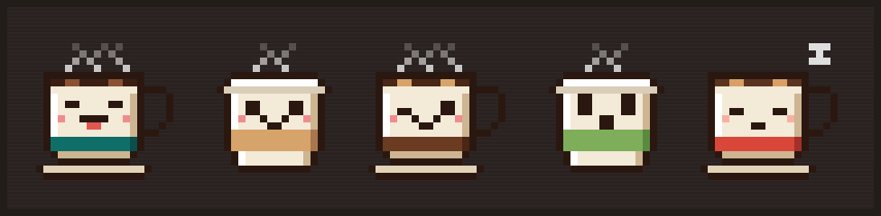

<div align="center">



# Espressionism

**The fine art of knowing when your espresso machine pays for itself.**

Find out when an espresso machine pays for itself. Compare your café habit with brewing at home: break-even, yearly spend and the real cost per cup.

</div>

---

## Motivation

A €3.50 flat white doesn't feel like much. Five days a week, fifty-two weeks a year, it's over €900. Meanwhile, a decent espresso machine costs about as much as a few months of café runs, and then each cup costs cents.

"Should I just buy a machine?" comes up all the time, and it's usually answered by gut feeling. Espressionism paints the full picture instead:

- **Break-even:** the month the machine has paid for itself
- **Yearly spend:** café vs. home, side by side, over as many years as you pick
- **Real cost per home cup:** beans, milk and upkeep, plus the machine's price spread across every cup you'll brew

Results update as you type, and every input lives in the URL, so you can send a friend the exact numbers that convinced you.

It's also a small, real-world playground for the TanStack ecosystem (Start, Router, Form and Charts) with a strict split between pure money math and UI.

> **Why the name?** _Espressionism_ has been my nickname for years: espresso meets the art movement. This is its first proper home.

## Overview

Espressionism has two halves: a **UI** with two pages, and an **agent** that answers questions in the calculator's chat. Both share the same demo store data and the same calculator core, so the store page, the calculator and the chat always agree.


| Part           | What it does                                                                                                                                                                                                                                                    | Status  |
| -------------- | --------------------------------------------------------------------------------------------------------------------------------------------------------------------------------------------------------------------------------------------------------------- | ------- |
| **Calculator** | Compares your café habit with brewing at home: break-even, yearly spend, real cost per cup. Inputs live in the URL. Robospresso can fill it from the chat, and in-browser AI agents through [WebMCP](#webmcp-let-an-ai-agent-fill-it-in).                       | ✅ Live |
| **Store**      | A demo shop of 10 espresso machines (made-up prices and ratings), with price and rating filters and sorting, all kept in the URL, plus a page for each product.                                                                                                 | ✅ Live |
| **Chat**       | Robospresso, the espresso concierge on the calculator page. He remembers the conversation, answers with text plus product cards and a "See all in the store" link (new tab), and can fill in the calculator for you. See [Robospresso chat](#robospresso-chat). | ✅ Live |
| **Agent**      | `POST /api/chat`: Gemini (direct, via the AI SDK) with the store search and three display tools, and the conversation held on the server. Without an API key it answers with a placeholder.                                                                     | ✅ Live |

## Stack

| Area            | Tools                                                                                                                                                      |
| --------------- | ---------------------------------------------------------------------------------------------------------------------------------------------------------- |
| Framework       | [TanStack Start](https://tanstack.com/start) (SPA mode) on [React 19](https://react.dev)                                                                   |
| Routing         | [TanStack Router](https://tanstack.com/router) with type-safe, URL-validated search params                                                                 |
| Forms           | [TanStack Form](https://tanstack.com/form) + [Zod](https://zod.dev) validation                                                                             |
| Chat            | [AI SDK](https://ai-sdk.dev) (`streamText`, UI message streams, `@ai-sdk/react`) with [Gemini](https://ai.google.dev) via Google AI Studio                 |
| AI agents       | [WebMCP](https://developer.chrome.com/docs/ai/webmcp) tools, with their status kept in a [Zustand](https://zustand.docs.pmnd.rs) store                     |
| Charts          | [react-charts](https://react-charts.tanstack.com) (TanStack Charts)                                                                                        |
| UI              | [shadcn/ui](https://ui.shadcn.com) on [Radix UI](https://www.radix-ui.com), [Tailwind CSS v4](https://tailwindcss.com), [Lucide](https://lucide.dev) icons |
| Fonts           | [Silkscreen](https://fonts.google.com/specimen/Silkscreen) for pixel headings, [Karla](https://fonts.google.com/specimen/Karla) for body text              |
| Toolchain       | [Vite+](https://viteplus.dev) (`vp`): dev server, build, [Oxlint](https://oxc.rs/docs/guide/usage/linter), [Oxfmt](https://oxc.rs) and tests               |
| Testing         | [Vitest](https://vitest.dev) + [Testing Library](https://testing-library.com) on [jsdom](https://github.com/jsdom/jsdom)                                   |
| Language        | [TypeScript](https://www.typescriptlang.org)                                                                                                               |
| Package manager | [pnpm](https://pnpm.io) workspaces, with supply-chain hardening (release-age delay, trust policy)                                                          |
| Dev tooling     | [TanStack Devtools](https://tanstack.com/devtools), [commitlint](https://commitlint.js.org) (Conventional Commits)                                         |

## Getting started

### Prerequisites

- [Node.js](https://nodejs.org) 24 (the version is pinned in `.nvmrc`)
- [pnpm](https://pnpm.io) 10, via Corepack

### Run it

```bash
git clone <repo-url> espressionism
cd espressionism

nvm use          # switch to Node 24
corepack enable  # provides the pinned pnpm version
pnpm install
pnpm dev         # http://localhost:3000
```

The TanStack Devtools panel sits in the bottom-right corner while the dev server is running.

### Scripts

Run from the repo root:

| Command              | What it does                                     |
| -------------------- | ------------------------------------------------ |
| `pnpm dev`           | Start the client dev server on port 3000         |
| `pnpm build`         | Production build (cached)                        |
| `pnpm check`         | Format check + lint + type check                 |
| `pnpm check --fix`   | Same, with autofixes                             |
| `pnpm test:unit`     | Unit tests                                       |
| `pnpm check:secrets` | Prove the API key never reaches the built bundle |
| `pnpm test:e2e`      | End-to-end tests (Playwright)                    |

## Robospresso chat

Ask Robospresso (the chat on the calculator page) recommends machines from the demo store and works out whether one pays off. A question travels like this:

1. The browser sends **only the new question**, the session id from the last reply, and the calculator's current values to `POST /api/chat`. The server holds the conversation itself (see [Memory](#memory)), so nobody can slip a forged history or fake prices to the model.
2. The agent (`packages/agent`) prompts Gemini with four tools. `search_espresso_machines` filters the catalog (the same tool the store page offers over WebMCP). `show_machines`, `show_store_link` and `fill_calculator` are **display tools**: the model picks which machines to show, and the server fills each card from the catalog, rejecting any slug the store doesn't sell; or the model names the calculator fields you mentioned, and the server merges them onto the page's values with the shared calculator core (`packages/calculator`, the same tool the page offers over WebMCP).
3. The answer streams back as an [AI SDK UI message stream](https://ai-sdk.dev/docs/ai-sdk-ui/stream-protocol): text parts plus tool parts.
4. The chat draws each part through a small renderer registry: text bubbles, skeleton cards while a call is in flight, then product cards and a store link that open in a new tab, so the conversation stays put. A calculator fill updates the form (the verdict mascots hop: "Filled by your agent") and leaves a small result card. See [How the chat draws an answer](#how-the-chat-draws-an-answer).

Every answer runs under fixed limits (4 model steps, 400 output tokens, 20 s). Upstream errors only reach the server log; the browser gets a generic apology and keeps whatever already arrived.

### Memory

Robospresso remembers the conversation on the server, like n8n's window-buffer memory: no database and nothing in browser storage.

- The first reply opens a **session** and tells the browser its id in a transient `data-session` part. The browser keeps the id in memory and sends it with the next question.
- The server keeps each session's turns as text, plus notes of what its display tools did (`[Cards shown: …]`, `[Calculator filled: …]`), so "the second one" or "and with three cups?" still make sense. Only completed answers are kept.
- Each answer reads a **window** of the newest turns (up to 40 turns or 24,000 characters), always starting on a question, so long chats never fail on length.
- Sessions expire after 30 idle minutes; at most 500 are kept (least recently used first out), 200 turns each. **New chat** starts a fresh one.
- If a session is lost (expired, a restarted dev server, another serverless instance), the chat says "I lost track of our earlier chat, so let's start fresh." and carries on. On Vercel this happens now and then, since each function instance has its own memory; the store sits behind a `ConversationStore` interface, so a shared store like Redis could replace it.
- In `pnpm dev`, a **Memory (dev)** section under the chat lists the sessions in LRU order (sizes only, never what was said).

### How the chat draws an answer

Nobody sends "draw a card". The server and the model only ever produce **tool calls and their results**. The chat decides what each one looks like. `cards-loading`, `cards`, `store-link` and `text` are view names that exist only in the browser.

Four layers, each with one job:

| Layer                      | Where                                                         | What it produces                                                                                                                                                                                                                          |
| -------------------------- | ------------------------------------------------------------- | ----------------------------------------------------------------------------------------------------------------------------------------------------------------------------------------------------------------------------------------- |
| **Model**                  | Gemini                                                        | Decides to call `show_machines({ slugs: ['gaggia-…', '…'] })`. It only names machines; it never writes a price.                                                                                                                           |
| **Tool**                   | `packages/agent/src/tools.ts`                                 | Runs the call on the server: looks each slug up in the catalog and returns `{ ok: true, items: [Machine…] }`, or `{ ok: false, errors }` for an unknown slug (the model sees the errors and retries).                                     |
| **Stream → message parts** | AI SDK (`streamText` on the server, `useChat` in the browser) | Streams the call as chunks (`tool-input-available`, then `tool-output-available`). `useChat` folds them into one part on the message: `{ type: 'tool-show_machines', state, input, output }`. The `state` moves forward as chunks arrive. |
| **Part → view → JSX**      | `features/chat/utils/parts.ts`, `components/MessageParts.tsx` | `toPartView(part)` (pure) reads the part's `type` and `state`, parses the output with the contract's Zod schema and returns a view, or `null` to draw nothing. `MessageParts` looks the view's `kind` up in `RENDERERS` and renders it.   |

How `toPartView` maps each part:

| Message part (`type` · `state`)                                                       | View            | Drawn as                                                    |
| ------------------------------------------------------------------------------------- | --------------- | ----------------------------------------------------------- |
| `text`                                                                                | `text`          | Robospresso's speech bubble                                 |
| `tool-show_machines` · `input-streaming` / `input-available`                          | `cards-loading` | One skeleton per requested slug (max 5)                     |
| `tool-show_machines` · `output-available`, `ok: true`                                 | `cards`         | Compact `MachineCard`s, new tab                             |
| `tool-show_store_link` · `output-available`, `ok: true`                               | `store-link`    | "See all N in the store" with the filters                   |
| `tool-fill_calculator` · `output-available`, `ok: true`                               | `calculator`    | "Calculator updated" card; the form is filled once          |
| `tool-search_espresso_machines` · any                                                 | none            | Nothing; while it runs the chat shows "Scanning the store…" |
| any display tool with `ok: false`, `output-error`, or an output that fails its schema | none            | Nothing; the model fixes the call and a later part draws    |

So one `show_machines` call shows on screen as skeletons first, then the same spot fills in with cards: the part keeps its `toolCallId` (the React key) and only its `state` changes. Because every view is built from the parsed tool **output** (catalog data) and never from the model's text, a card can't show a made-up price.

To add a new kind of answer, such as a comparison table:

1. **Agent:** add a `compare_machines` tool in `tools.ts` with a flat, `.strict()` input, and put its output schema in `contract.ts` (plus its entry in `RobospressoTools`).
2. **Instructions:** tell the model when to call it (`instructions.ts`).
3. **Client:** add a `case 'tool-compare_machines'` to `toPartView` that returns a new view kind, and a renderer for that kind in `RENDERERS`. TypeScript rejects a view kind without a renderer.

### Use your own Gemini key

Without a key the chat answers with a placeholder, so tests, CI and keyless previews work as-is. The chat header says which one you're on: a green **Live** badge when a model is configured, a red **Offline** one ("Demo mode") when it isn't. It's decided when the app is built (is the key set?), so restart `pnpm dev` or redeploy after changing it; only that yes/no reaches the browser, never the key. To talk to Gemini locally:

1. Create a key in [Google AI Studio](https://aistudio.google.com/apikey) (restrict it to the Gemini API).
2. Copy `packages/client/.env.example` to `packages/client/.env` and set `GOOGLE_GENERATIVE_AI_API_KEY`. `GEMINI_MODEL` is optional (default `gemini-3.5-flash-lite`).
3. Restart `pnpm dev`.

On Vercel, add `GOOGLE_GENERATIVE_AI_API_KEY` as a **Secret** environment variable. Never give these variables a `VITE_` prefix: that would ship the key to the browser.

## WebMCP: let an AI agent fill it in

The calculator offers one [WebMCP](https://developer.chrome.com/docs/ai/webmcp) tool, `fill_calculator`. An agent in the browser can send any of the inputs (usual drink, café price, cups a day, machine price, …) and get back the break-even, the totals and a one-line verdict. The form fills in as if you'd typed it, and the URL updates so the result stays shareable. A banner at the top of the page says whether WebMCP is on.

WebMCP is a proposed web standard that's still in an early preview. Enabling the Chrome flag only lets the page register tools; you also need an agent that reads them. Agents that drive the page through the DOM (most browser-automation extensions) don't see WebMCP tools and fall back to typing into the form.

Prerequisites:

- Chrome with the `chrome://flags/#enable-webmcp-testing` flag (below).
- The [WebMCP Model Context Tool Inspector](https://chromewebstore.google.com/detail/webmcp-model-context-tool/gbpdfapgefenggkahomfgkhfehlcenpd) extension, or another extension that speaks WebMCP.
- A Gemini API key from [Google AI Studio](https://aistudio.google.com/), for the Inspector's chat.

To try it:

1. Use Chrome and open `chrome://flags/#enable-webmcp-testing`. Set it to **Enabled** and relaunch Chrome.
2. Install the Inspector and pin it from the puzzle-piece menu next to the address bar. It lists a page's tools, lets you run them by hand and chat with Gemini once you paste in your API key.
3. Open Espressionism (`pnpm dev`, then http://localhost:3000). The banner should read "WebMCP on: 1 tool ready for your agent".
4. Ask the agent something like:

   > I buy two lattes a day at €4.20, five days a week. Would a €700 machine pay for itself within three years?

Public sites can join the [WebMCP origin trial](https://developer.chrome.com/origintrials/#/register_trial/4163014905550602241) (Chrome 149+) so visitors don't need the flag. This project doesn't register for it yet.

## The cost model

All figures assume 52 weeks a year and flat prices.

- **Café per year** = price per drink × cups a day × days a week × 52
- **Home per year** = cost per home cup × cups per year + upkeep per year
- **Break-even** = machine price ÷ ((café per year − home per year) ÷ 12) months. If a home cup costs as much as a café cup, the machine never pays for itself.
- **Real cost per home cup** = (machine price + home per year × years) ÷ cups over those years

The math lives in pure functions in `packages/calculator/src/cost-model.ts`, shared by the page and Robospresso, and each one is unit-tested.

## Project layout

```
api/
  chat.ts          Vercel Function: POST /api/chat → the agent
packages/
  client/          TanStack Start frontend (the UI)
    src/
      features/
        calculator/   form, verdict, stats, charts and the WebMCP tool
        store/        store and product pages, filters, machine sprites
        chat/         Ask Robospresso: useChat, part renderers, cards
        mascot/       pixel-art sprites and SVG renderer
        webmcp/       tool registration hook, status store (Zustand) and banner
        common/       shared form fields, ChartCard
      routes/         thin route entry points
    test/unit/        tests mirroring src/features
    test/e2e/         Playwright specs
  agent/           chat handler, session memory, Gemini reply, tools, HTTP contract
  calculator/      calculator schema, pure cost model + fill tool, shared by UI and agent
  store/           demo catalog + pure filter/sort, shared by UI and agent
docs/
  assets/          README images
```

See [CLAUDE.md](./CLAUDE.md) for the full conventions.

## License

[MIT](./LICENSE) © 2026 Georgios Georgiou. Forks and copies must keep the copyright and license notice.

<div align="center">
<br />
<sub>Brewed with ☕ and far too many pixels.</sub>
</div>
