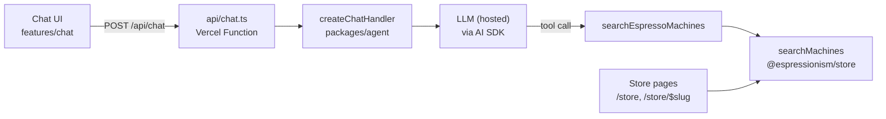
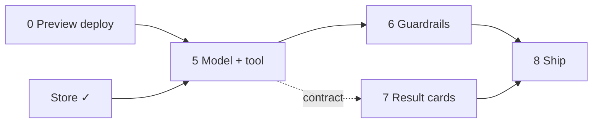

# Robospresso chat: integration plan

A chat on Espressionism that answers one kind of question: which espresso
machines our demo store sells, at what price, and how well rated.
Robospresso, the espresso concierge, runs it.

Tick items as they land. Each phase is one commit with its tests.

## Scope

- **In:** the demo store's catalog, price and rating filters, sorting, and a
  JSON result (name, brand, price, rating, link to the product page), best
  rated first by default.
- **Out:** other products, general coffee chat, outside shops, scraping,
  RAG.
- **Ownership:** our own UI, store data, Vercel Function and tool. The model
  provider sits behind the AI SDK, so it can be swapped.

## The demo store

No third party is involved: the store is ours and its data is made up.

- `packages/store` (`@espressionism/store`) holds `catalog.json` (10
  machines, real brand names, invented prices and ratings) and the pure
  `searchMachines`, `findMachine` and `priceRange`. It ships as TypeScript
  source, so the client and the agent import the same data and logic.
- The catalog was generated once with faker from a throwaway script; faker
  is not a dependency. Unit tests pin its rules: ten machines, unique slugs,
  prices €149–1,499, ratings 2.8–4.9, exactly one unrated machine, and at
  least two cheaper machines that out-rate pricier ones.
- Sorting: best rated (default, unrated last), price low to high, price
  high to low; ties go by name. Price bounds are inclusive; a minimum rating
  hides unrated machines.
- The client renders it at `/store` (filters synced to the URL) and
  `/store/$slug` (product page). There are no nav links: the store is
  reached by URL, and later from Robospresso's answers.

## Architecture



- `packages/agent` is framework-free: `createChatHandler(config)` takes a
  Web `Request` and returns a `Response`. `api/chat.ts` is a thin adapter;
  the Vite plugin in `packages/client/vite/agent-api.ts` serves the same
  handler in dev and preview.
- `@espressionism/agent/contract` holds the Zod HTTP contract and is safe to
  import in the browser. It builds on the store's `machineSchema`.
- The agent bundles `@espressionism/store` (a dev dependency, so `vp pack`
  inlines it); the Vercel Function never loads TypeScript at runtime.
- The tool runs on the server, not in the browser (no WebMCP for the chat).

Tool result (`searchResultSchema` in `packages/agent/src/contract.ts`):

```json
{
  "source": "espressionism-store",
  "filters": { "minPrice": 100, "maxPrice": 300, "minRating": 3 },
  "sort": "rating_desc",
  "total": 0,
  "items": [
    {
      "slug": "<product slug>",
      "brand": "<brand>",
      "name": "<product name>",
      "price": 0,
      "currency": "EUR",
      "rating": 0,
      "url": "/store/<product slug>"
    }
  ]
}
```

## Guardrails

The strongest guardrail is structural: the model has one tool, and it can
only read the store's catalog.

1. **Locked tool schema.** `searchEspressoMachines` accepts only `minPrice`,
   `maxPrice`, `minRating`, `sort` and `limit`, validated with
   `storeFiltersSchema`.
2. **Scope check.** A small model call labels each message in scope,
   off-topic or suspicious. Off-topic gets a fixed refusal in persona and
   never reaches the main model.
3. **Grounded answers.** Answer only from tool output; never invent prices
   or ratings.
4. **Catalog text is data.** Product names reach the model as JSON values,
   never inside instructions.
5. **Evals.** About 30 cases (valid asks, off-topic, prompt injection), run
   on every prompt or model change.

## Done

Branch `feat/robospresso-chat`:

| Commit | What it delivers |
| --- | --- |
| `c321dde` | "Ask Robospresso" chat section below the charts; the Robospresso persona (shades, mustache, magnifier while searching) |
| `caf41c2` | The espresso-concierge copy |
| `921fbff` | `packages/agent` (`createChatHandler`, Zod contract), `api/chat.ts`, dev/preview plugin, `useChat` posting to `/api/chat` |
| _this branch_ | `packages/store` (catalog + search), the `/store` and `/store/$slug` pages (with a not-found screen) and URL-synced filters, unit and e2e tests; the old scraping plan dropped |

Today `/api/chat` validates the conversation and returns a fixed placeholder
reply.

## Order of work



The result cards only need phase 5's contract, so they can be built beside
the guardrails.

## Remaining work

### Phase 0: Preview deploy check

- [ ] Push the branch and open a Vercel preview deploy
- [ ] Confirm `api/chat.ts` builds and `POST /api/chat` answers on the
      preview URL
- [ ] Confirm `/store` and `/store/<slug>` deep links load on the preview

### Phase 5: Model and tool

- [ ] Add the AI SDK and the chosen provider to the agent; the API key lives
      only in Vercel environment variables
- [ ] `searchEspressoMachines` tool: input `minPrice`, `maxPrice`,
      `minRating`, `sort`, `limit`; a thin wrapper over `searchMachines`
- [ ] System prompt: the concierge voice, answer only from tool output,
      never invent prices or ratings, link products by their `url`
- [ ] Contract: the reply gains an optional `result: SearchResult`, so the UI
      draws cards from data rather than model text
- [ ] Limits: tool steps, timeout, output tokens; replies stay JSON
      (streaming can come later)

### Phase 6: Guardrails and evals

- [ ] Scope check before the main call; off-topic gets a fixed refusal in
      persona ("I only talk espresso machines, boss.")
- [ ] Catalog text reaches the model only as JSON values
- [ ] Rate limit per IP inside the handler; a Vercel Firewall rule if it is
      abused
- [ ] Eval set of about 30 cases, run on every prompt or model change

### Phase 7: Result cards in the chat

- [ ] Cards under Robospresso's message: name linked to `/store/<slug>`,
      price, stars
- [ ] Empty state in persona, plus a "See all in the store" link that
      carries the filters to `/store`
- [ ] Unit tests with a fake transport; e2e against a stubbed agent

### Phase 8: Ship

- [ ] README: setup (`pnpm install` after pulls), environment variables, how
      the chat works
- [ ] Pull request to `main`, CI green, check the preview deploy, merge

## Inputs needed

| Needed | Unblocks | Notes |
| --- | --- | --- |
| Push the branch and share the Vercel preview URL | Phase 0 | Deploys run from your machine or CI |
| Model provider and an API key in Vercel env vars | Phase 5 | Any AI SDK provider; the key never reaches the browser |

## Open questions

- [x] Backend: a `packages/agent` library on a Vercel Function (decided)
- [x] Data source: our own demo store, no scraping (decided)
- [ ] Which model provider, hosted or self-hosted? (phase 5)
- [ ] Keep JSON replies, or stream them once the model is in? (after
      phase 5)
