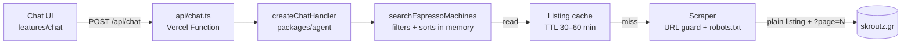
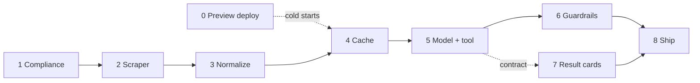

# Robospresso chat: integration plan

A chat on Espressionism that answers one kind of question: which espresso
machines are listed on [skroutz.gr](https://www.skroutz.gr/), at what price,
and how well rated. Robospresso, the espresso concierge, runs it.

Tick items as they land. Each phase is one commit with its tests.

## Scope

- **In:** the fixed search "espresso machine", price and rating filters,
  sorting, and a JSON result (name, price, rating, review count, link),
  sorted by price by default.
- **Out:** other products, general coffee chat, other shops, RAG. Results
  live in memory only.
- **Ownership:** our own UI, Vercel Function, scraper and cache. The model
  provider sits behind the AI SDK, so it can be swapped.

## Compliance

Skroutz gets only the plain listing request. Every filter, sort and limit
runs in our code after the fetch. Rules from
[robots.txt](https://www.skroutz.gr/robots.txt), checked 2026-11-04:

| Rule in robots.txt | What it means for us |
| --- | --- |
| `*filter_id=*`, `*excluded_filter_ids=*`, `/c/*/a/*`, manufacturer IDs blocked for all bots | No upstream filters of any kind. Price and rating filters run in memory. |
| `/api/`, `/apiv2/`, `/suggest` blocked | Parse HTML pages, never the site's internal JSON endpoints. |
| AI crawlers (ClaudeBot, GPTBot…) blocked from `/*?`; `anthropic-ai` blocked site-wide | The model never browses Skroutz. Our scraper fetches; the model only sees our JSON. |
| General `*` rules allow listing pages | Fetch the plain listing plus `?page=N`, nothing else. |

How the code enforces it:

- One guard checks every outgoing URL: host `www.skroutz.gr`, the fixed
  listing path, query params limited to `page`, and `robots-parser` must
  allow it.
- robots.txt is re-fetched every 24 h. If the rules tighten, the scraper
  stops rather than breaking them.
- Honest User-Agent with a contact, one request at a time 1–2 s apart,
  backoff on 429/5xx, no proxies.

## Architecture



- `packages/agent` is framework-free: `createChatHandler(config)` takes a
  Web `Request` and returns a `Response`. `api/chat.ts` is a thin adapter;
  the Vite plugin in `packages/client/vite/agent-api.ts` serves the same
  handler in dev and preview.
- `@espressionism/agent/contract` holds the Zod HTTP contract and is safe to
  import in the browser.
- The model only sees the tool's JSON; it never builds or visits a Skroutz
  URL.

Tool result (`searchResultSchema` in `packages/agent/src/contract.ts`):

```json
{
  "query": "espresso machine",
  "source": "skroutz.gr",
  "fetchedAt": "<ISO timestamp>",
  "filters": { "minPrice": 100, "maxPrice": 300, "minRating": 3 },
  "sort": "price_asc",
  "total": 0,
  "items": [
    {
      "name": "<product name>",
      "price": 0,
      "currency": "EUR",
      "rating": 0,
      "reviewCount": 0,
      "url": "https://www.skroutz.gr/s/..."
    }
  ]
}
```

## Guardrails

The strongest guardrail is structural: the model has one tool, and the
search phrase is hardcoded on the server.

1. **Locked tool schema.** `searchEspressoMachines` accepts only `minPrice`,
   `maxPrice`, `minRating`, `sort` and `limit`. None of these ever reach a
   Skroutz URL.
2. **Scope check.** A small model call labels each message in scope,
   off-topic or suspicious. Off-topic gets a fixed refusal in persona and
   never reaches the main model.
3. **Grounded answers.** Answer only from tool output; never invent prices
   or ratings.
4. **Scraped text is data.** Product names reach the model as JSON values,
   never inside instructions.
5. **Evals.** About 30 cases (valid asks, off-topic, prompt injection), run
   on every prompt or model change.

## Done

Branch `feat/robospresso-chat`:

| Commit | What it delivers |
| --- | --- |
| `c321dde` | "Ask Robospresso" chat section below the charts; the Robospresso persona (shades, mustache, magnifier while searching) |
| `caf41c2` | The espresso-concierge copy |
| `921fbff` | `packages/agent` (`createChatHandler`, Zod contract), `api/chat.ts`, dev/preview plugin, `useChat` posting to `/api/chat` |

Today `/api/chat` validates the conversation and returns a fixed placeholder
reply.

## Order of work



Phases 0 and 1 can start now. Phase 0's cold-start numbers settle the cache
design in phase 4; the result cards only need phase 5's contract, so they
can be built beside the guardrails.

## Remaining work

### Phase 0: Preview deploy check

- [ ] Push the branch and open a Vercel preview deploy
- [ ] Confirm `api/chat.ts` builds and `POST /api/chat` answers on the
      preview URL
- [ ] Set the function's `maxDuration` in `vercel.json` (a full listing
      scrape takes several seconds)
- [ ] Log instance starts to see how often the in-memory cache would start
      empty

### Phase 1: Compliance gate

No request goes to the live site until this is done; work on saved pages
can start before.

- [ ] Read the Skroutz terms of use on automated access
- [ ] Pick the contact address for the scraper's User-Agent

### Phase 2: Scraper

- [ ] Find the listing URL the "espresso machine" search lands on and fix it
      as a constant
- [ ] URL guard: host `www.skroutz.gr`, that listing path only, query params
      limited to `page`; tests that filter and sort params are refused
- [ ] robots.txt check with `robots-parser`, re-fetched every 24 h; scraping
      stops if robots.txt is unreachable or disallows the URL
- [ ] Polite fetcher: honest User-Agent, one request at a time 1–2 s apart,
      timeout, backoff on 429/5xx, at most 10 pages
- [ ] Listing parser with `cheerio`, preferring JSON-LD or embedded data over
      CSS selectors; tests on saved HTML fixtures

### Phase 3: Normalize, filter, sort

- [ ] Parse Greek prices (`1.234,56 €` → `1234.56`), ratings and review
      counts
- [ ] Validate each item with `machineSchema`; drop malformed rows and count
      the drops
- [ ] Filters `minPrice`, `maxPrice`, `minRating` ("Rated over 3 stars");
      sorts by price up or down and by rating, unrated last; `limit`
- [ ] Build the `SearchResult` the contract already defines

### Phase 4: Cache

- [ ] `ListingCache` interface with an in-memory version inside the handler,
      TTL 30–60 min
- [ ] Single flight: requests that arrive during a fetch share it
- [ ] On a failed refresh, serve the stale listing with its `fetchedAt`
- [ ] Using phase 0's numbers: keep it in memory, or back the same interface
      with Vercel KV or Upstash

### Phase 5: Model and tool

- [ ] Add the AI SDK and the chosen provider to the agent; the API key lives
      only in Vercel environment variables
- [ ] `searchEspressoMachines` tool: input `minPrice`, `maxPrice`,
      `minRating`, `sort`, `limit`; the search phrase stays hardcoded
- [ ] System prompt: the concierge voice, answer only from tool output,
      never invent prices or ratings
- [ ] Contract: the reply gains an optional `result: SearchResult`, so the UI
      draws cards from data rather than model text
- [ ] Limits: tool steps, timeout, output tokens; replies stay JSON
      (streaming can come later)

### Phase 6: Guardrails and evals

- [ ] Scope check before the main call; off-topic gets a fixed refusal in
      persona ("I only talk espresso machines, boss.")
- [ ] Scraped text reaches the model only as JSON values
- [ ] Rate limit per IP inside the handler; a Vercel Firewall rule if it is
      abused
- [ ] Eval set of about 30 cases, run on every prompt or model change

### Phase 7: Result cards in the chat

- [ ] Cards under Robospresso's message: name linked to Skroutz, price,
      stars, review count
- [ ] Empty state in persona, plus a "from skroutz.gr, fetched HH:MM" line
- [ ] Unit tests with a fake transport; e2e against a stubbed agent, never
      live Skroutz in CI

### Phase 8: Ship

- [ ] README: setup (`pnpm install` after pulls), environment variables, how
      the chat works
- [ ] Pull request to `main`, CI green, check the preview deploy, merge

## Inputs needed

| Needed | Unblocks | Notes |
| --- | --- | --- |
| Push the branch and share the Vercel preview URL | Phase 0 | Deploys run from your machine or CI |
| A read of the Skroutz terms, or a link to them | Phase 1, live fetching | Decides whether scraping goes ahead |
| A contact address for the scraper's User-Agent | Phase 2 | A project address is fine |
| One espresso-machine listing page saved as HTML | Phase 2 parser | Becomes the test fixture; two pages if it paginates |
| Model provider and an API key in Vercel env vars | Phase 5 | Any AI SDK provider; the key never reaches the browser |

## Open questions

- [x] Backend: a `packages/agent` library on a Vercel Function (decided)
- [ ] What do the Skroutz terms say about automated access? (phase 1)
- [ ] Which model provider, hosted or self-hosted? (phase 5)
- [ ] Is the in-memory cache enough on Vercel, or does it need Vercel KV or
      Upstash? (phase 0 decides, phase 4 builds)
- [ ] Keep JSON replies, or stream them once the model is in? (after
      phase 5)
